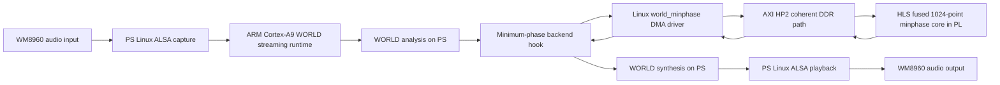

# Architecture and Data Flow

The accelerator transforms one 513-bin log spectrum into a 513-bin complex minimum-phase filter. It performs two 1024-point FFT passes and folds the exponential, cosine, and sine work into the HLS kernel. The surrounding WORLD analysis and synthesis algorithms, queueing, and ALSA capture/playback remain on the ARM PS.

## Why this split

Profiling in the source project identified WORLD synthesis as a major PS cost, but the accepted Round30 candidate is a narrower HLS migration of the minimum-phase analysis stage. A broader FFT or synthesis-pulse exploration exists in later rounds and is not silently included in this package's deployed candidate. The PL contribution is a real numerical kernel called through AXI/DMA; it is not a generic I/O bridge.

## Evidence boundary

- Round16: host/HLS numerical comparison and RTL cosimulation.
- Round17: out-of-context implementation of the kernel.
- Round18: routed integration in the audio system, under the constraints recorded in its report.
- Round20: board vector and file numeric comparison.
- Round23: bounded 20-second live audio with user-confirmed audible output.
- Round30: reboot persistence and active PL runtime counters.

Each result proves a different property; see the individual reports in `report/`.
