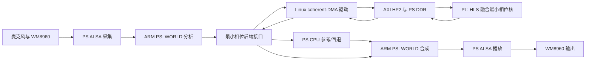

# WORLD 最小相位 PS+PL 设计报告

> 本报告按《全国大学生嵌入式芯片与系统设计竞赛 2026 选题指南（AMD）》第 3.3 节自主选题赛道编写，并按初级组考察侧重说明。初级组资格由队伍成员学历决定，应以报名审核信息为准。报告中的通过判定仅引用已有记录和用户验收，不表示本轮重新上板测试。

## 1. 项目摘要

本项目将融合式 1024 点最小相位频谱核接入 Wildfire Zynq-7020 实时 WORLD 语音处理流程。ARM Cortex-A9 处理系统（PS）运行 WORLD 数据流、所选阶段以外的分析与合成、进程管理和 ALSA 音频输入输出；可编程逻辑（PL）中的 HLS 加速器负责选定的最小相位频谱计算。Linux 缓存一致 DMA 驱动在 PS DDR 与 PL 核之间传送数据。

本项目的设计目标是验证一条具体、可测量的 PS/PL 协作边界及其板端集成，不是提出新语音转换模型，也不声称整个 WORLD 流程在 PL 中运行或取得端到端加速收益。Round9 离线五项客观指标和 Round10 主观音色由用户确认通过；Round23 有效实时语音测试及 Round30 持久启动证据由用户接受为稳定性/延迟验收依据。Round24 因有效浊音帧为零而排除。各项证据的范围和限制见第 6 节及对应轮次报告。

## 2. 选题背景与创新点

### 2.1 选题动机与实际问题

WORLD 语音处理由多个分析、变换和合成阶段组成。将整个流程一次性迁入 FPGA，接口范围大、数值定位困难，也难以区分硬件误差和算法误差。因此本项目选择固定 1024 点最小相位频谱阶段作为边界：每次输入长度固定，输入输出格式明确，可以与 WORLD 软件参考逐向量比对，并可通过运行计数确认板端实际调用。

要解决的工程问题是：怎样在保留 PS 上既有 WORLD 与音频链路的前提下，把一个可确定性验证的数值阶段迁入 PL，并处理 DDR 缓冲区、DMA 一致性、控制寄存器、运行时选择、错误回退和开机部署。项目结果是对上述 PS/PL 集成路线的实现与测量，不是对语音身份转换难题的完整解决。

### 2.2 已有工作与本项目定位

| 已有工作/参考 | 已有能力 | 本项目继承或补足的内容 | 证据边界 |
| --- | --- | --- | --- |
| WORLD 0.3.5 软件参考路径 | 在 PS/主机提供最小相位计算基准 | 保留为 CPU 对照与 HLS 黄金参考 | 不等同于新的语音转换算法 |
| 项目原有 Zynq 音频工程 | 提供 PS、ALSA/WM8960、音频 DMA 和既有 AXI 结构 | 保留原音频通路，并为新计算核分配独立 HP2 DDR 通路 | 原始 PetaLinux 工程和镜像没有随当前包交付 |
| 通用 HLS FFT/最小相位实现 | 可将变换或算子映射到 FPGA | 将 FFT、倒谱及指数/三角运算融合为 WORLD 接口匹配的最小相位 IP，并接入 Linux DMA 驱动 | 贡献属于工程集成和数值核实现；没有声称算法首创 |
| 本项目 Round16-30 | 从协同仿真逐步到 OOC、整机布线、板端数值、实时音频和持久启动 | 保存每一层证据，并依据失败轮次调整运行时和启动控制 | 不同轮次证明不同属性，不能合并成超出证据的结论 |

现有材料没有提供系统化的外部同类产品基准或文献综述，因此本报告不声称相对所有前人工作的学术创新。可核验的工程创新点是：在既有 WORLD 音频系统内定义并实现了实际参与计算的 PS/PL 分界、独立 HP2/coherent-DMA 数据通路、CPU/PL 后端选择与遥测，以及候选版本的受控持久启动与恢复机制。

## 3. 设计原理与功能框图

### 3.1 工作原理

HLS 顶层 `world_minphase` 接收 513 个 `float32` 对数频谱点，为 1024 点变换生成 513 个复数 `float32` 最小相位滤波器频点。核内融合两次 1024 点 FFT 通路及相关倒谱、指数、余弦和正弦计算。PS 通过 Linux `/dev/world_minphase` 驱动发起处理；驱动使用 coherent DMA 缓冲区，PL 主接口经独立互连访问 PS HP2 DDR。成功结果回到 WORLD 合成阶段；CPU 模式使用软件实现，PL 模式的设备打开或 ioctl 错误按运行时契约报告失败，非 1024 点请求走 CPU 回退并计数。

图 1 展示数据路径和控制边界。CPU 参考/回退路径与 PL 路径由 PS 侧后端选择；PL 只替代所选最小相位阶段。采集、其余 WORLD 阶段、合成和播放仍在 PS 软件侧。

## 4. 软硬件划分依据与接口设计

### 4.1 划分依据

该阶段的向量维度固定、数值输出可比、调用频率可计数，适合作为小范围硬件边界。PS 继续承担灵活的 WORLD 控制流、队列、设备 I/O 和不属于候选 PL 核的算法。这样既保留软件参考路径，也使 PL 数值误差、DMA 行为和整机资源可以分层测量。项目没有以“PL 占比”作为目标，也没有把其他轮次探索的合成脉冲实现写入 Round30 候选。

### 4.2 PS 与 PL 接口契约

| 项目 | 约定/实测配置 |
| --- | --- |
| 器件 | Wildfire Zynq-7020，`xc7z020clg400-2` |
| 时钟 | PS `FCLK_CLK0`，集成记录为 100 MHz |
| 输入 | 513 个 `float32` 对数频谱点 |
| 输出 | 513 个 `float32` 实部及 513 个 `float32` 虚部 |
| HLS 顶层 | `world_minphase`，变换长度 1024 |
| AXI-Lite 控制窗口 | `0x43C70000`；指针参数窗口 `0x43C80000` |
| 数据通路 | HLS 输入/输出主接口经 `minphase_mem` 连接 PS `S_AXI_HP2` |
| 完成与超时 | HLS 控制/中断；记录的软件路径使用有界轮询 |
| Linux 用户接口 | `/dev/world_minphase`，ioctl `WORLD_MINPHASE_PROCESS` |
| 缓冲区语义 | Linux coherent-DMA 驱动管理 PS DDR 缓冲区；确切寄存器/结构布局以源码头文件和驱动为准 |
| 后端选择 | `WORLD_MINPHASE=cpu` 使用软件路径；`WORLD_MINPHASE=pl` 使用设备接口；非 1024 点请求记入 CPU fallback |

权威布局见 `src/kernel/world_minphase_ioctl.h`、`src/kernel/world_minphase_dma.c` 和 `src/ps/world_minphase_pl.cpp`。本表是接口摘要，修改实现时必须以这些源文件和硬件导出文件为准。记录的物理音频格式为 ALSA 32 kHz、S24_LE、双声道；算法内部流为 16 kHz 单声道，运行时显式转换。

## 5. 优化过程与性能/资源对比

### 5.1 迭代过程

1. **Round16：数值基线。** Vitis HLS 2026.1 生成 RTL，XSIM 对 24 组 WORLD 黄金向量通过，最大相对 L2 误差 `8.53141669198e-7`。仿真监视器仍报告地址依赖警告，因此只判定测试平台数值通过，不当作形式验证。
2. **Round17：核级实现。** 在 100 MHz 约束下完成 HLS 核 OOC 布局布线，WNS `+1.327 ns`、WHS `+0.053 ns`，0 个 setup/hold 失败端点。此结果不替代整机签核。
3. **Round18：整机集成。** 新增专用 HP2 互连、AXI-Lite 控制映射和 HLS IP，完成 BD validate、整机综合/布局布线和位流生成。外部音频 I/O 延迟约束仍有缺项。
4. **Round20：板端数值和受控文件对照。** 24/24 向量通过；两个 5 秒文件 CPU 与 PL 路径逐项对比，无超时、无 fallback，最大 PCM16 差 1。该轮没有录放音。
5. **Round21/23：实时链路修正。** Round21 由于用户没有听到声音而未通过实时音频门；检查后重新确认当轮准备并在 Round23 获得明确可听反馈。Round23 的结论限于 20 秒有效语音测试。
6. **Round29/30：启动稳定性修正。** Round29 暴露厂商 `music-button` 遗留播放器占用 PCM 的启动竞争；Round30 采用服务级停止、按进程身份精确清理、等待 PCM 释放和原子更新状态，验证正常重启后候选版本启动且 PL 调用计数增加。

### 5.2 优化前后实测对比

| 对比维度 | 基线/优化前 | 融合最小相位 PL 方案 | 对比说明 |
| --- | --- | --- | --- |
| 整机逻辑资源 | 原完整 WORLD-exp 工程：8,026 LUT、13,283 FF、6 BRAM Tile、9 DSP | Round18 路由整机：13,910 LUT、20,145 FF、9.5 BRAM Tile、47 DSP | 增量为 5,884 LUT、6,862 FF、3.5 BRAM Tile、38 DSP；该增量对应新增 PL 核和互连，不等同于可任意复用的剩余资源 |
| 核级资源 | Round16 HLS 估算：10,007 LUT、7,732 FF、8 BRAM18K、38 DSP；估算时钟 7.300 ns | Round17 OOC 布线：4,996 LUT、5,769 FF、7 BRAM18K 等效、38 DSP；实现周期 8.673 ns，WNS +1.327 ns | 综合估算与 OOC 实现是不同报告阶段；数值仅列示演进，不把差值解释成同条件优化收益 |
| 文件转换墙钟时间 | PS CPU：male1 2.845253 s，male4 2.822582 s | 最小相位 PL：male1 2.748740 s，male4 2.747420 s | Round20 每个输入均为 5 秒受控文件；此处只报告已测数值，不据此宣称端到端性能收益或实时延迟改善 |
| 数值误差 | PS CPU 与原 v23：两文件均逐字节一致 | PL 对 PS CPU：SNR 97.371389/96.942108 dB，最大 PCM16 差 1；24 向量最差相对 L2 `8.53141669193e-7` | 证明被测输入上的数值接近，不代替语音主观质量或多说话人验收 |
| 实时运行观察 | Round21：数字流程运行，但未获得可听输出，未通过 | Round23：20 秒、1,079 浊音帧、分析最大批次 34.605 ms、4,857 次 PL 调用、fallback/xrun/ALSA 错误均为 0 | 用户确认声音可听且效果与 PS 类似；不声称完整长时稳定性或 P99 端到端延迟 |

表中整机资源来自 [Round18 整机集成报告](world_minphase_integration_round18_20261029.md)，核资源来自 [Round16 协同仿真](world_minphase_cosim_round16_20261029.md) 和 [Round17 OOC 报告](world_minphase_ooc_round17_20261029.md)，转换时间和数值结果来自 [Round20 板端数值报告](world_minphase_board_round20_20261029.md)，实时数据来自 [Round23 实时报告](world_minphase_prompt_live_round23_20261029.md)。它们来自不同验收轮次，只有表中明确标注同一测试条件的项目才可横向比较。项目按用户要求不主张性能收益；保留测量值是为了满足可核查的设计报告要求。

## 6. 功能验证与结论边界

| 证据层级 | 已记录结果 | 能证明什么 | 不能证明什么 |
| --- | --- | --- | --- |
| Round16 RTL 协同仿真 | 24 组通过；最大相对 L2 `8.53141669198e-7`；延迟 32,231–32,232 cycles | 该确定性测试集上的核数值和仿真行为 | 整机资源、板端运行或形式正确性 |
| Round17 OOC | 100 MHz 约束下 WNS +1.327 ns、WHS +0.053 ns、0 个 setup/hold 失败 | 独立 HLS 核实现结果 | PS/AXI/音频整机签核 |
| Round18 整机布线 | WNS +0.856 ns、WHS +0.029 ns、0 DRC Error；3 条输入和 6 条输出缺少外部 I/O delay | 被记录约束下的整机内部布线结果 | 完整外部音频接口时序签核 |
| Round20 板端数值 | 24/24 向量；两段受控文件 SNR 97.371/96.942 dB，最大误差 1 PCM16 count；0 timeout/fallback | 板端 DMA 核数值及指定文件转换对比 | 实时采录放、试听、长时稳定性 |
| Round23 实时音频 | 20 秒、1,079 浊音帧；PL calls 4,857、fallback 0、零 xrun/ALSA 错误；最大分析批次 34.605 ms | 有效讲话条件下限时实时运行；用户确认可听并评价“效果和ps类似” | 60 秒以上长稳、统计性延迟分布或 PL 优于 PS |
| Round30 持久启动 | 正常重启选择 `READY_CANDIDATE`，采集/播放 RUNNING，调用从 2,278 增至 13,751 | 候选程序开机启动和 PL 活动计数 | 长时有效讲话稳定性或完整语音转换质量门 |

应用音色方面，Round9 五项离线指标为身份 0.5200、P10 0.4719、源泄漏 0.0591、UTMOS 3.0789、CER 0.1020；用户确认其为固定男性输入者目标的基本通过，并确认原始 Round10 主观音色通过。这些离线结果不能推出 PL 候选的陌生多人泛化、板上注册目标或目标音质已全部通过。

## 7. 大模型协作记录

本节是基于可追溯项目任务记录整理的代表性交互摘要，不是完整私人聊天导出。提示词以用户任务原意摘要呈现；模型回答列为当时决策摘要，纠错项链接到可核验的报告或交付改变。不得把摘要误读为逐字引语。

| 阶段/提示词摘要 | 模型回答/产物 | 自我纠错与证据 |
| --- | --- | --- |
| 目标锁定：“按 2026-10-30 的 Round30 PS+PL 项目制作完整提交，不要用早期通用方案。” | 锁定 `PL-20261027-01` 部署版本 `a8f6f8f32b159eaea277354118220c633f31fbc2`，将源工程和提交项目分开 | 检查后发现开发分支后续另有合成脉冲实验，未把它们混进 Round30 候选；以来源 SHA 和 Release 清单限定范围 |
| 赛道适配：“依据 AMD 指南判断原 PetaLinux PS+PL 项目能否参赛，是否必须改 PYNQ？” | 第 3.3.2 允许 RTL、HLS、PS 软件及组合；初级组推荐而非强制 PYNQ | 修正早期把“PYNQ 推荐”说成通用要求的风险；报告明确本项目为 Linux/PetaLinux C++ PS + HLS PL，未声称采用 PYNQ |
| 完整性：“制作符合官方目录的完整提交，性能收益不要夸大；已有 Round23/30 和 Round9/10 通过结论按用户确认记录。” | 整理源码、板卡文件、报告、技能、复现说明和验收清单 | 初版“完整提交”表述容易被误解为所有复现输入均齐全；核实后明确 PetaLinux 镜像/原工程缺失、干净环境整机布线未重建，且把 Round24 无有效语音排除 |
| 纠错指令：“原始 Round10 听感也是通过；Round23/30 作为稳定性和延迟依据。” | 将 Round10 最终裁决和 Round23/30 用户接受状态写入提交摘要 | 保留同期失败轮次与证据边界；不把 20 秒测试改写为长时稳定性实测，也不宣称 PL 音质优于 PS |
| 本轮报告要求：“对照 3.3.5.3 判断 PDF 是否完整；若不完整就按官方要求修改。” | 当前修订加入背景/对比、功能框图、接口约定、实测优化表、AI 轨迹、Skill 提炼和可执行复现步骤 | 审查发现旧 PDF 只有 2 页摘要，图示仅链接外部文档、优化对比缺失、AI/Skill 过程不足；本修订将这些缺口显式补入正文，并保留尚未满足的从零复现限制 |

### 7.1 智能体工作流

本项目采用按阶段串行的模型协作工作流，依次完成需求与赛道核对、锁定源分支和提交、分层读取轮次证据、工程包与目录整理、设计/接口/验收报告编写、Skill 提炼、PDF 生成与双重检查（文本提取和逐页渲染）、Git diff 与测试、PR 提交。工作流要求在每次阶段交接时携带源码 SHA、证据路径和已知限制。本提交包没有记录多个智能体并行分工，因此不声称使用了并行多智能体系统。

## 8. 技能包的提炼过程

### 8.1 来源观察与归纳

Skill 不是泛化的经验口号，而是从重复出现且有报告可追溯的故障中归纳：

| 来源失败/观察 | 提炼出的可复用规则 | 在本项目中的有效性证据 | 适用边界 |
| --- | --- | --- | --- |
| Round16 仿真监视器对地址依赖发出警告，虽然 24 例数值通过 | 分开记录数值仿真通过与形式/依赖风险，不因测试通过而抹掉警告 | Round16 报告保留 6,720 条警告并继续列为签核风险 | 只证明证据纪律有效，不代表警告已消除 |
| Round17 OOC 时序通过但不能覆盖 PS、AXI、音频系统 | OOC、整机布线、板端数值、实时 I/O 必须分层验收 | Round18 重新做整机实现并记录外部 I/O 约束缺项 | 用于分层 FPGA 验证；项目/器件变化时需重定基线 |
| Round21 数字流程在运行但没有可听输出；Round23 明确确认后通过 | 实时音频测试必须记录操作者准备、输入有效性和实际可听反馈 | Round23 记录 1,079 浊音帧、运行计数及用户反馈 | 用户听感只适用于该轮、该输入和该配置 |
| Round24 60 秒运行没有有效语音帧 | 无有效语音的运行不能作为语音稳定性证据 | 报告将 Round24 排除出稳定性判断 | 不对其余更长时间稳定性做推断 |
| Round29 启动时残留 `aplay` 占用 PCM | 启动清理按进程身份精准处理，等待设备释放并保留回滚，不做全局杀进程 | Round30 正常重启后候选就绪、PCM 运行、PL 调用递增 | 针对记录的板端启动竞态；其他服务需重新识别 |
| Windows 长路径及 Vivado MCP 长命令曾造成生成/调用失败 | 使用短外部构建根目录和短诊断命令；长流程放入受版本控制 Tcl 并保存日志 | Round18 记录长路径失败后相同源码在短路径通过；MCP 技能记录会话和器件核对 | 与 Windows/Vivado 安装、过滤驱动相关，其他主机需先复核 |

### 8.2 技能验证方式与限制

仓库 `skill/` 目前包含板级启动、DMA 一致性、黄金参考比对、Vivado MCP/GitHub 协作和 PS/PL 提示词流程。每项说明适用范围、方法和失效条件；`skill/04_vivado_mcp_git_github/references/round_lessons.md` 保留具体触发条件与排查过程。其项目内验证依据是对应 Round16-30 报告、脚本和板端记录；指标索引另由 `python data/metrics/scripts/validate_metrics.py` 校验。

边界：提示词流程和技能目录没有经过第二支队伍或第二块板卡独立前向验证；提示词工作流本身不能证明设计通过。跨板卡、跨 PetaLinux/Vivado 版本或迁移到 PYNQ 时，路径、驱动 API、寄存器、时钟和测试方法必须重新核实。通用 PYNQ Skill 可获指南额外加分，但本项目未使用 PYNQ，也未提交与题目无关的通用 PYNQ Skill，因此不申领该加分。

## 9. 复现说明

### 9.1 从零准备

1. 克隆公开仓库并进入任务分支 `agent/Pi-debug-cmd/SUBMIT-20261101-02`；核对 `git rev-parse HEAD` 和 `coummucation.md` 中的基准提交。
2. 安装 Vivado/Vitis 2026.1、HLS 和 `xc7z020clg400-2` 器件支持；确认许可证可用。WORLD 0.3.5 源树必须符合项目构建脚本中的版本/哈希检查。
3. 从 GitHub Release `round30-submission-20261101-v4` 下载 `voice7020_project_sources.zip`、精简源码包和 `voice7020.xsa`，按 `board/artifacts/round30/MANIFEST.md` 校验 SHA-256。把完整源码 ZIP 解压到干净短路径，在 Vivado 2026.1 打开 `.xpr` 并执行 `open_bd_design`/`validate_bd_design`。
4. 运行 HLS/ARM 构建前设定短的外部构建目录及 WORLD 源码路径。核级仿真/综合命令和 ARM 运行时命令见 [`reproduction.md`](reproduction.md)；整机工程脚本及环境变量也在该文件。对照 Round16-18 记录检查实际报告，不把历史报告当本机新构建结果。
5. 主机端执行 `python -m unittest sim.test_world_minphase_boot -v` 和 `python data/metrics/scripts/validate_metrics.py`。确定性 HLS 测试使用 `sim/tb_world_minphase.cpp` 与 24 组固定向量；通过 HLS C 仿真和 RTL 协同仿真后再对照保存的误差门槛。
6. 板端复现需要可恢复的 Wildfire Zynq-7020、匹配的启动镜像、WM8960 音频链和 Round30 部署材料。板端载荷/配置流程见 `board/hardware_setup.md`、`board/artifacts/round30/MANIFEST.md` 和对应 Round 报告。安装前核对设备身份、基线哈希和回滚方案；录音、播放、试听或改启动配置需遵守操作者准备与恢复流程。

### 9.2 复现限制与本次交付缺口

本项目包和 Release **没有 PetaLinux 2022.2 工程/BSP、可启动镜像、`.ko` 模块和 WORLD 运行时可执行文件**。`.xsa` 只描述硬件，不能恢复设备树、内核、rootfs 或启动策略。原始厂商 PetaLinux 工程、完整 WORLD 0.3.5 外部树、Vivado 实现 run 输出也不在公开 Git 中；完整 Vivado 源码 ZIP 已做打开及 BD 验证，但未在干净机器重新全流程布线。因此，现有材料可以供他人审查代码、校验发布制品并复现独立 HLS 核测试，不能声称只凭仓库即可从空机器重建整套板端运行环境并重复实时语音演示。

如需完整板端从零复现，必须补交匹配的 PetaLinux 工程/BSP 或经过哈希验证的可启动镜像及软件运行文件，并解决外部音频 I/O 时序约束后完成干净环境构建/板测。获取路线见 [`petalinux_image_acquisition.md`](../board/petalinux_image_acquisition.md)。

## 10. 按官方要求的自评

本报告现在在正文中给出选题背景与创新点、功能框图、PS/PL 划分和接口、带实测数据的资源/性能表、大模型协作和纠错摘要、Skill 提炼与验证边界，以及复现步骤；具体证据可沿链接追溯。就“设计报告内容”而言，七项均有对应章节。

这不代表整个作品已经满足所有提交门槛：初级组器件范围允许 Zynq-7000，且赛道实现方式不限定，PYNQ 是推荐方向而非强制；但官方要求作品上板运行并提供实测输出，以及保证他人从零复现。项目已有板端实测证据，但 PetaLinux 工程/镜像和运行文件尚缺，整机干净环境重建尚未完成。故**报告覆盖完整，公开项目的端到端从零复现仍未完整满足要求**。本项目的实际队员资格仍由报名审核确定。
