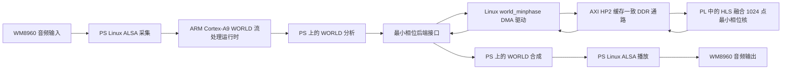

# 系统架构与数据流

加速器将 513 点对数频谱转换为 513 点复数最小相位滤波器。它执行两次 1024 点 FFT，并在 HLS 核中融合指数、余弦和正弦运算。周边 WORLD 分析与合成算法、队列管理以及 ALSA 录放音仍由 ARM PS 执行。

## 划分依据

源项目的性能分析显示 WORLD 合成是 PS 的主要开销之一，但已接受的 Round30 候选方案只将最小相位分析阶段迁移到 HLS。后续轮次中还探索了更大范围的 FFT 和合成脉冲处理，但这些内容没有被混入本提交包所对应的已部署候选版本。PL 执行的是通过 AXI/DMA 调用的实际数值计算核，而非通用输入输出桥接逻辑。

## 证据范围

- Round16：主机/HLS 数值对比及 RTL 协同仿真。
- Round17：该核的独立模块实现（OOC）。
- Round18：在报告所列约束下完成音频系统整机布线集成。
- Round20：板端向量和文件数值对比。
- Round23：20 秒限时实时音频测试，用户确认听到声音。
- Round30：重启后保持部署状态，并确认 PL 运行计数器递增。

每项结果验证的属性不同，详情见 `report/` 中的对应报告。
